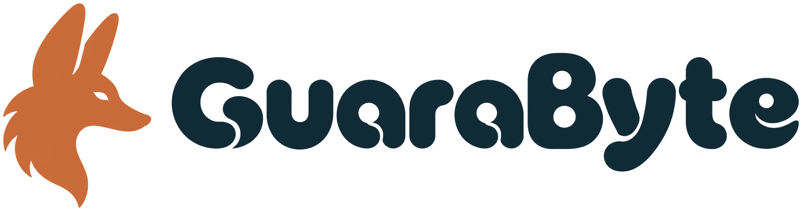

  <picture>
    <source media="(prefers-color-scheme: dark)" srcset="./assets/guarabyte-logo-negativo.png">
    
  </picture>

<h1 align="center">Gabriel Morais Gurgel</h1>

  Fundador da GuaraByte · Sistemas sob medida · Parceiro da Agência Gestalt · Parauapebas, PA

---

## Sobre mim

Sou Gabriel, fundador da **GuaraByte**, empresa de criação de software (CNPJ 65.248.153/0001-06).
Desenho e construo sistemas sob medida, do primeiro protótipo ao produto em produção.

Também sou parceiro da **Agência Gestalt**, em Parauapebas, PA. Pela agência, desenvolvo produtos como
FiMEI, Gestalt CRM, VotarisHub, SOT e o Back Office de afiliados.

O que eu entrego:

- SaaS multi-tenant com Next.js, TanStack Start e Supabase.
- CRMs e automações de WhatsApp com agentes de IA.
- Painéis de vendas, afiliados, comissões e pagamentos.
- Lojas online e páginas de venda.

## Stack

  
  
  
  

  
  
  
  
  
  

  
  
  
  
  
  
  

  
  
  
  
  

## Projetos no ar

| Projeto | O que faz | Stack |
| --- | --- | --- |
| [FiMEI](https://www.fimei.com.br) | Controle financeiro para MEI: lançamentos, lembrete do DAS e notas fiscais. | Next.js · Supabase · Stripe |
| [Gestalt CRM](https://gestaltcrm.com.br) | CRM para WhatsApp com agentes de IA que atendem e qualificam leads. | Next.js · Supabase |
| [VotarisHub](https://votarishub.com.br) | Captação de leads, inscrições e votação, em modelo multi-tenant. | TanStack Start · Supabase · Cloudflare |
| [SOT](https://sotapp.com.br) | Quadros e kanban para times organizarem o trabalho. | TanStack Start · Supabase |
| [Radar de Vendas](https://raddardevendas.com.br) | IA que lê o atendimento no WhatsApp e mede conversão por vendedor. | Next.js · Prisma · PostgreSQL |
| [Back Office Gestalt](https://gestaltbackoffice.com.br) | Afiliados, comissões e saques via Pix dos produtos Gestalt. | Next.js · PostgreSQL · Drizzle |
| [Bordadeiras de Serra Pelada](https://bordadeirasdeserrapelada.com.br) | Loja online da associação de bordadeiras. [Ver código](https://github.com/gabigurgeldev/ecommerce-bordadeiras) | Next.js · Supabase |
| [Sellgen](https://sellgenoficial.vercel.app) | Propostas comerciais em PDF com assinatura online. | Next.js · Supabase |

## Código aberto

- [GMOTION](https://github.com/gabigurgeldev/GMOTION): motion graphics programático sobre o Remotion.
- [GOCCODE](https://github.com/gabigurgeldev/GOCCODE): plugin de compressão de tokens para o Kilo Code.
- [ecommerce-bordadeiras](https://github.com/gabigurgeldev/ecommerce-bordadeiras): loja em Next.js 15 e Supabase.
- [votacao-gastronomica](https://github.com/gabigurgeldev/votacao-gastronomica): votação de público e jurados para festival gastronômico.

## No GitHub

  
  

A maior parte do código dos produtos fica em repositórios privados. Os cartões mostram só a atividade pública.

## Contato

Quer um sistema sob medida? Fale comigo no [WhatsApp](https://wa.me/5594984304355).

---

  GuaraByte · CNPJ 65.248.153/0001-06 · Parauapebas, PA

